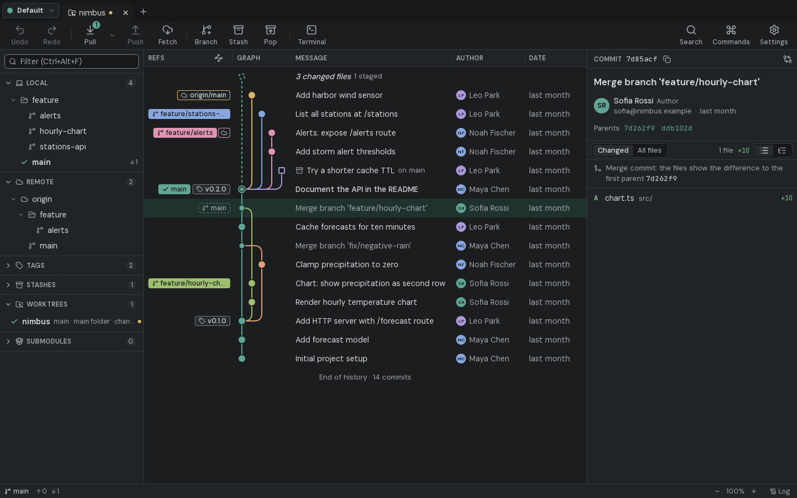
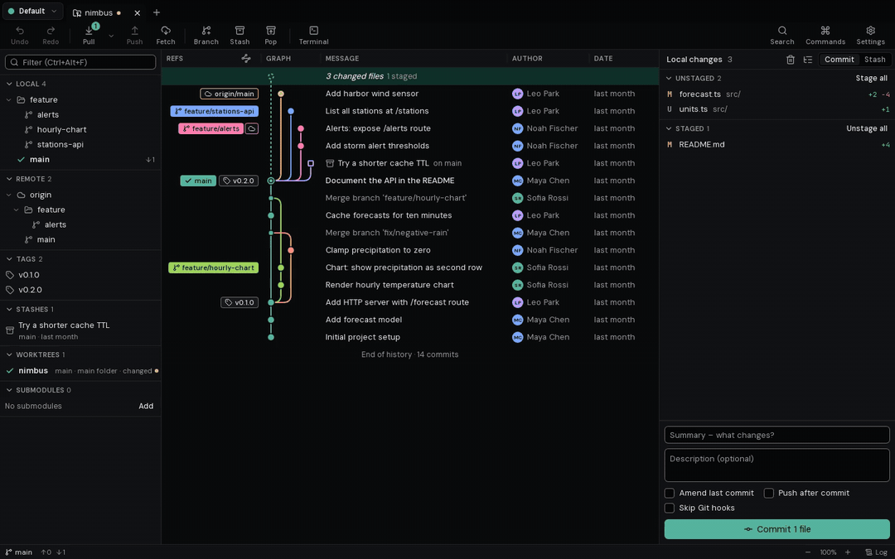
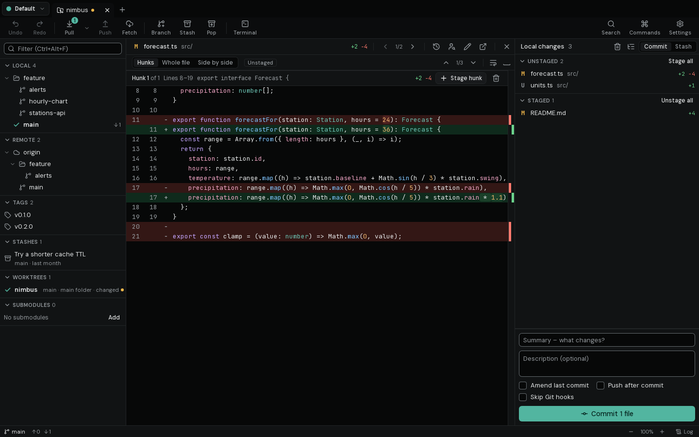
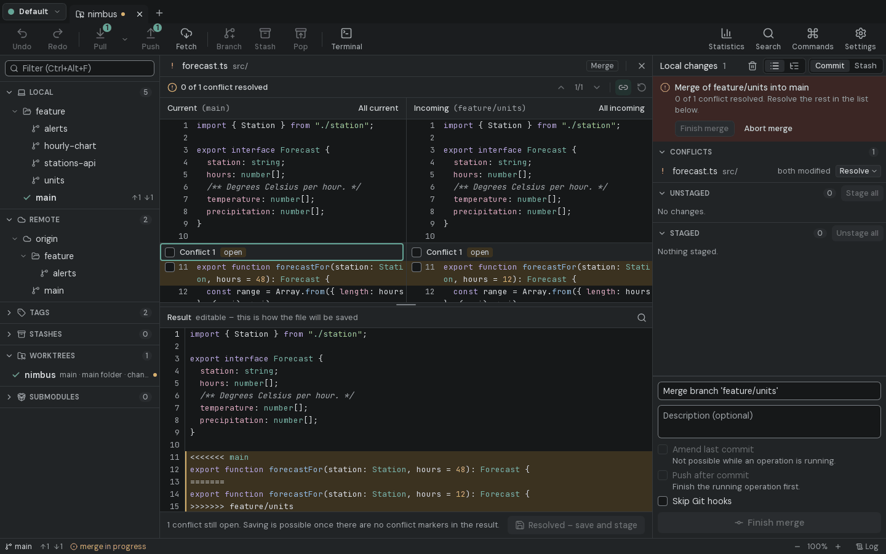
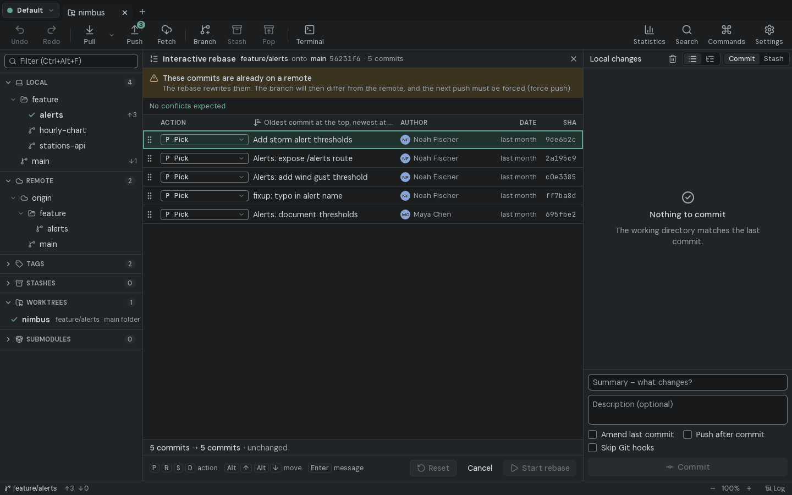
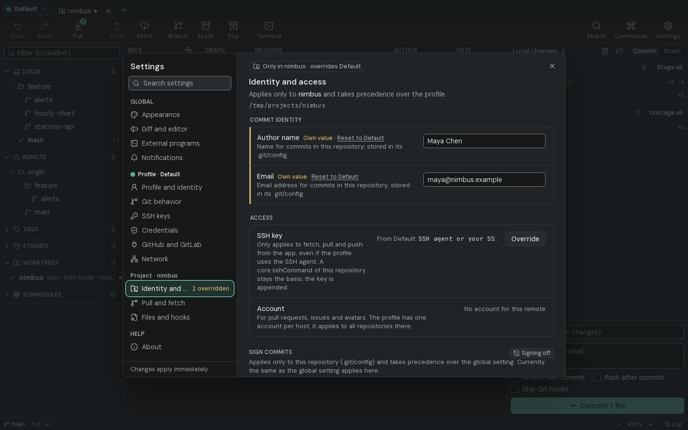

<div align="center">


# Forkyard

**A fast, local Git client for the desktop – with a real commit graph, line staging, a three-way merge tool and an Undo button for Git.**

No account. No telemetry. No cloud. Your repositories stay on your machine.

[](https://github.com/abgebaumt/forkyard/actions/workflows/ci.yml)
[](LICENSE)


[Download](https://github.com/abgebaumt/forkyard/releases/latest) · [Features](#features) · [Build from source](#build-from-source) · [Contributing](CONTRIBUTING.md)

<picture>
  <source media="(prefers-color-scheme: light)" srcset="docs/images/graph-light.png">
  
</picture>

</div>

## Why Forkyard?

Most graphical Git clients either hide Git behind a simplified model or want you to sign in to a
vendor cloud. Forkyard does neither. It drives the real `git` on your machine, shows you what
actually happens, and makes the risky parts safe:

- **Undo for Git.** Reset, rebase, discard, branch delete – destructive actions create a backup ref
  first, so one click (or `Ctrl+Z`) brings your work back.
- **Fast on big repositories.** The commit graph is laid out in Rust and drawn on a canvas; history
  loads page by page, file watching and status run in the background.
- **Private by design.** Credentials live only in your OS keychain. No telemetry, no account, no server.
  Besides your own Git and host operations (and author avatars from GitHub, which you can turn off),
  the only automatic network request is an optional daily update check to api.github.com that sends
  nothing but the app version in the User-Agent – it can be switched off in Settings › About.
- **Safe with unknown repositories.** Repositories whose config or hooks would run programs stay
  locked until you trust them.

<p align="center"></p>

## Features

<table>
<tr>
<td width="50%" valign="top">

**History and graph**
- Commit graph with branch lanes, merge lines, ref labels and a WIP row
- Search by message, SHA and author; file history and blame
- Compare any two commits, or a commit with your working directory
- Pin, hide or solo branches; smart branch visibility for large repos
- Collapse merges, see unpushed and unpulled commits at a glance
- Reflog view and bisect right in the graph
- Issue numbers and ticket keys in messages become links (Jira, Linear, YouTrack, Redmine or your own)

**Committing**
- Stage files, hunks or single lines – CRLF, Latin-1 and missing final newlines included
- Amend, commit and push in one step, commit templates, co-author trailers
- Side-by-side and inline diff with word-level highlighting and syntax colours
- Image diff side by side, as a swipe, an onion skin or a pixel difference
- Stash single lines and hunks
- Built-in editor with Markdown preview

</td>
<td width="50%" valign="top">

**Branching and merging**
- Drag a branch onto another to merge, rebase or open a pull request
- Interactive rebase: pick, reword, squash, drop and reorder
- Three-pane conflict tool with an editable result
- Conflict preview before a merge, rebase, cherry-pick or revert – without touching your files
- Rebase stacked branches together (`--update-refs`), push several branches and tags at once, delete branches on the remote
- Cherry-pick, revert, reset (soft/mixed/hard), stashes with names and per-file apply

**Everything around it**
- Tabs for several repositories, workspaces, profiles (e.g. work and private)
- Settings on three levels: global, per profile, per project (identity, SSH key, pull mode)
- HTTPS and SSH credentials, SSH key generation, proxy and custom CA
- GitHub, GitLab, Gitea/Forgejo, Bitbucket Cloud and Azure DevOps: pull requests and issues through the official APIs
- Worktrees, submodules that follow checkouts, Git LFS with file locks, Git Flow, commit signing (GPG/SSH), hooks
- Custom commands with placeholders in the palette and context menus
- Statistics per repository: activity, authors, hotspots, bus factor, code age
- Command palette, keyboard shortcuts, embedded terminal, light and dark theme
- A `forkyard` command line, and local crash reports that never leave your machine
- Optional daily update check against the GitHub releases: a quiet hint when a new version is out

</td>
</tr>
</table>

<p align="center">
  
  
</p>
<p align="center">
  
  
</p>

## Install

Download the installer for your system from the [latest release](https://github.com/abgebaumt/forkyard/releases/latest):

| System | x64 (Intel/AMD) | ARM64 |
| --- | --- | --- |
| Windows 10/11 | `.msi` or `-setup.exe` | `-setup.exe` |
| macOS 11 or newer | `_x64.dmg` (Intel) | `_aarch64.dmg` (Apple Silicon) |
| Linux (Debian, Ubuntu, Mint …) | `.deb` | `.deb` |
| Linux (Fedora, openSUSE, RHEL …) | `.rpm` | `.rpm` |
| Linux (any distribution) | `.AppImage` | `.AppImage` |

`SHA256SUMS.txt` in every release lists the checksums. The builds are not signed with a paid
certificate yet: Windows SmartScreen may ask once (“More info” → “Run anyway”), and on macOS open
the app the first time with right-click → Open.

Forkyard uses the Git installed on your system (version 2.39 or newer). The interface is available
in English and German.

## Build from source

You need [Node.js 22](https://nodejs.org), a current stable [Rust](https://rustup.rs) toolchain and Git.
On Linux, install the WebKitGTK dependencies first:

```bash
# Ubuntu / Debian
sudo apt install libwebkit2gtk-4.1-dev libgtk-3-dev libsoup-3.0-dev libjavascriptcoregtk-4.1-dev \
  librsvg2-dev libayatana-appindicator3-dev libxdo-dev libdbus-1-dev
```

```bash
git clone https://github.com/abgebaumt/forkyard.git
cd forkyard
npm install
npm run app            # development build with hot reload
npm run tauri build    # installers in target/release/bundle
```

## How it works

```
React UI ──invoke──▶ Tauri binding ──▶ Rust core (gitcore) ──process──▶ git
   ▲                                      ├──▶ SQLite (app state only)
   └────────── events (repo changed, jobs) ┴──▶ OS keychain (secrets)
```

- **Git is the source of truth.** Commits, refs and stashes are always read from Git, never cached in a database.
- **One write at a time per repository.** Reads run in parallel, background reads never take Git's lock.
- **The UI never runs Git.** Every operation is a typed command in the Rust core, tested against real temporary repositories.

More in [CONTRIBUTING.md](CONTRIBUTING.md).

## Contributing

Issues and pull requests are welcome – see [CONTRIBUTING.md](CONTRIBUTING.md) for the setup and
the checks CI runs. Please report security problems privately as described in [SECURITY.md](SECURITY.md).

## License

Forkyard is free software under the [GNU General Public License v3.0](LICENSE).
